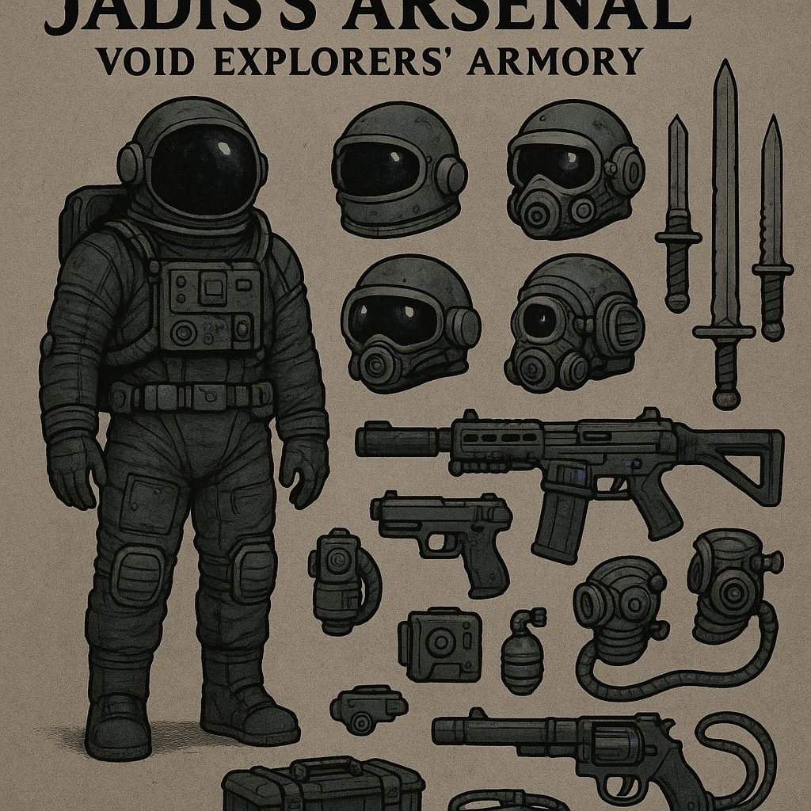

Armory is AXIOM's development weapon framework. It provides a disciplined, non-destructive control plane for engaging tools that can intercept execution without performing real-world actions in v0.1.

State model
Armory is either DISARMED or ENGAGED with a single weapon and profile. Only one weapon may be active at a time.

State and safety
Armory keeps a local runtime state file and favors safe defaults. When in doubt, treat the system as blocked and resolve state intentionally.

Basic usage
- armory list
- armory status
- armory engage stabilizer_ops
- armory disarm
- armory-run -- ./cockpit.sh

Overwatch integration
Overwatch can source the Armory UI banner and display it as a single line.
Example: source armory/core/lib/armory_ui.sh; armory_ui_banner
